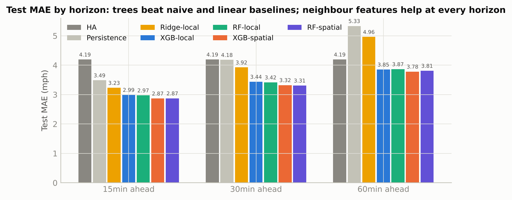

# Traffic Flow Forecasting on METR-LA — Phase 1 (Classical ML)

Repository: https://github.com/madaankartik/traffic-aml-project

**Project 4 · Team T082 · Section B**
*Multi-Agent Traffic Flow Control via Graph Attention Networks and LWR Models*
Advanced Machine Learning & Deep Learning (CSAI) — Phase 1 evaluates the machine-learning component only.

> Predict congestion on a road network and test whether network-aware learning improves on independent
> road-segment forecasts. Signal control is simulated only; this project does not claim live traffic control.

Phase 1 delivers the **independent-segment ML baseline** the brief asks for — lagged speed, calendar and
segment features; per-segment XGBoost and a multi-output Random Forest; chronological splits; MAE/RMSE/MAPE by
horizon and for peak vs off-peak — plus a controlled ablation with **LWR-motivated neighbour features** that
quantifies the "gap" a Graph Attention Network will target in Phase 2.

## Results at a glance (test split, 4–27 June 2012, masked metrics over 207 sensors)

<!-- RESULTS_TABLE:start -->
| Model | MAE 15 | MAE 30 | MAE 60 | RMSE 60 | MAPE 60 (%) | F1 congestion 60 |
|---|---|---|---|---|---|---|
| HA | 4.19 | 4.19 | 4.19 | 7.86 | 13.06 | 0.64 |
| Persistence | 3.49 | 4.18 | 5.33 | 10.27 | 14.42 | 0.64 |
| Ridge-local | 3.23 | 3.92 | 4.96 | 8.44 | 15.05 | 0.55 |
| XGB-local | 2.99 | 3.44 | 3.85 | 7.26 | 11.61 | 0.69 |
| RF-local | 2.97 | 3.42 | 3.87 | 7.25 | 11.66 | 0.69 |
| XGB-spatial | 2.87 | 3.32 | 3.78 | 7.07 | 11.22 | 0.71 |
| RF-spatial | 2.87 | 3.31 | 3.81 | 7.06 | 11.30 | 0.70 |
<!-- RESULTS_TABLE:end -->

* Adding neighbour (upstream/downstream) features to the same XGBoost learner reduces MAE at every horizon
  (**4.1 %** at 15 min, **1.8 %** at 60 min), about three times more in the commute peaks
  than off-peak, and improves **147 / 207** sensors. One-hop features help least at 60 min — the horizon
  where a multi-hop graph model (Phase 2) should add the most.
* Errors concentrate in the congested regime (< 35 mph) and in weekday peaks — the spatio-temporal part of the
  problem that Phase 2 addresses.



## Repository layout

```
traffic-flow-phase1/
├── README.md · requirements.txt · pyproject.toml · run_all.sh
├── src/trafficml/        the method (6 modules)
│   ├── config.py         paths, constants, hyper-parameters — single source of truth
│   ├── data.py           load METR-LA, mask outages, build the sensor graph
│   ├── features.py       lag / calendar / historical-average / neighbour features, chronological split
│   ├── models.py         HA, persistence, Ridge, per-segment XGBoost, multi-output Random Forest
│   ├── evaluate.py       masked MAE / RMSE / MAPE, peak vs off-peak, per sensor, congestion detection
│   └── plots.py          consistent figure style
├── scripts/              the pipeline, in order: download_data → run_eda → run_experiments →
│                         make_result_figures → fill_docs → build_notebooks
├── notebooks/            01_eda.ipynb · 02_features_and_models.ipynb (executed, outputs included)
├── tests/                8 unit tests (split integrity, lags, neighbour features, masked metrics)
├── data/                 README (provenance, checksums, quality audit, split) · raw/metr-la.h5 (download script) · sensor_graph/ (4 files)
├── results/              12 files: metrics by horizon / peak / hour / congestion / validation,
│                         per_sensor_mae, feature_importance, best_iterations, EDA summary, split, config
├── figures/              21 PNG figures used by the report, slides and notebooks
├── report/               report_simple.html → report_simple.pdf (the Phase 1 report) · refs.bib (reference list)
└── slides/               the Phase 1 presentation (.pptx)
```

## Reproduce everything

One command (about 90 min on 2 CPU cores; `./run_all.sh --fast` skips the two Random Forests):

```bash
python -m venv .venv && source .venv/bin/activate && pip install -r requirements.txt
./run_all.sh
```

Or step by step:

```bash

python scripts/download_data.py          # ~65 MB
python scripts/run_eda.py                # ~1 min
python scripts/run_experiments.py        # ~80 min on 2 CPU cores (all 7 models); or pick models:
#   python scripts/run_experiments.py --models HA Persistence XGB-local XGB-spatial
python scripts/make_result_figures.py
jupyter nbconvert --execute --inplace notebooks/*.ipynb
python -m pytest tests -q                # 8 unit tests (split integrity, lags, neighbour features, metrics)
# report: every number in report/report_simple.html comes from results/*.csv; to re-export the PDF, open the
# HTML in Chrome and print to PDF (A4, background graphics on)
```

A fixed seed (`config.RANDOM_SEED = 42`) and `results/config.json` make every run reproducible.

## Method summary

| Step | What we do | Why |
|---|---|---|
| Data quality | Mask 0 mph readings (8.1 %) as missing; characterise outage runs; verify the DCRNN adjacency construction | 0 mph is a detector outage, not a jam |
| EDA | Daily/weekly profiles, autocorrelation, correlation vs road distance, congestion share by hour | Identify the temporal memory and the local spatial dependence to exploit |
| Features | 12 own lags, window statistics, cyclic calendar encodings, train-only historical average + deviation, upstream/downstream neighbour means at lags 0–2, neighbourhood min & congested fraction | LWR: congestion propagates along the graph; HA captures the weekly cycle |
| Split | Chronological 70/10/20 with a one-hour gap; validation used only for early stopping/model selection | No leakage from serial dependence |
| Models | HA, Persistence, Ridge, XGBoost per (sensor, horizon) with early stopping, multi-output RF per sensor; each in a *local* and a *spatial* variant | Brief: "XGBoost per segment or multi-output Random Forest"; ablation isolates the value of neighbour information |
| Metrics | Masked MAE/RMSE/MAPE at 15/30/60 min; peak vs off-peak; by hour; per sensor (maps); congestion-detection F1 (< 35 mph) | Brief: horizon-wise metrics and peak/off-peak comparison; maps show where models fail |

## Data

METR-LA (Jagadish et al., 2014; Li et al., ICLR 2018): 207 loop detectors, 5-minute average speed (mph),
1 Mar – 27 Jun 2012, with sensor coordinates, road-network distances and the Gaussian-kernel adjacency.
`scripts/download_data.py` pulls public GitHub mirrors of the DCRNN release and checks shapes.

## Team

| Member | Contribution |
|---|---|
| Kartik Madaan | Data pipeline: acquisition and masking, sensor graph, repository and reproducibility; exploratory data analysis |
| Arhan Alam | Feature engineering, LWR-motivated neighbour features, chronological split, leakage tests |
| Chirag Lalwani | Model training: per-segment XGBoost, multi-output Random Forest, Ridge, hyper-parameters |
| Siddhanth Sadshiv Raikar | Models (baselines, training runs, validation evidence) and the report (literature review, assembly) |
| Abhijeet Dey | Evaluation and results: masked metrics, peak/off-peak, ablation, congestion detection and maps |

## References (selection)

Li et al. (2018) DCRNN, ICLR · Veličković et al. (2018) Graph Attention Networks, ICLR · Lighthill & Whitham (1955),
Richards (1956) LWR model · Chen & Guestrin (2016) XGBoost, KDD · Breiman (2001) Random Forests · Bergmeir & Benítez (2012)
time-series validation · Zheng et al. (2019) CityFlow, WWW. Full list in `report/refs.bib`.
